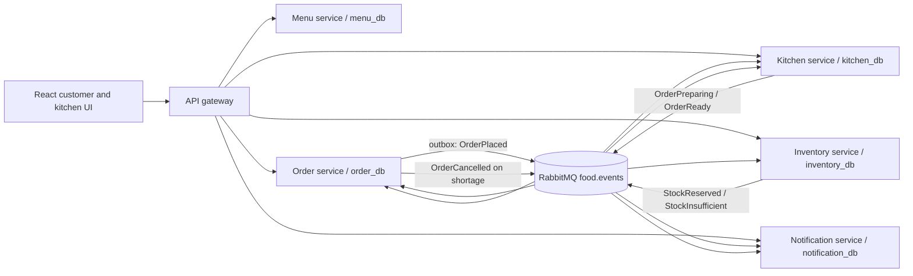

# Architecture and event guide

## Runtime layout

Each service has a dedicated PostgreSQL database and role. The gateway is stateless. RabbitMQ uses a durable topic exchange and durable service queues. Consumers validate the event envelope and maintain an event ID primary key in `processed_events` to make handling idempotent. The order service writes its order and an `outbox` record in one database transaction; its publisher retries unsent rows after restart. Handler errors are retried up to three times and then routed to the shared dead-letter queue.

## Event catalogue

| Event | Routing key | Publisher | Consumers | Purpose |
|---|---|---|---|---|
| `OrderPlaced` | `order.placed` | order | kitchen, inventory, notification | Start the independent reactions to a new order. |
| `StockReserved` | `stock.reserved` | inventory | order | Confirm that requested stock was reserved. |
| `StockInsufficient` | `stock.insufficient` | inventory | order, notification | Reject an order and tell the customer why. |
| `OrderCancelled` | `order.cancelled` | order | kitchen, inventory | Cancel the ticket and release an existing reservation. |
| `OrderPreparing` | `order.preparing` | kitchen | order | Move the order to preparation. |
| `OrderReady` | `order.ready` | kitchen | order, notification | Mark the order ready and notify the customer. |

The main chain is `OrderPlaced` → `StockInsufficient` → `OrderCancelled`. `OrderPlaced` has three independent consumers, demonstrating fan-out. Event envelopes include event ID, version, occurrence time, correlation ID, type and validated data.

## Local run

Requires Docker Compose and Node.js 20 or later. Run `npm install`, then `npm run build`, then `docker compose up --build`. Open `http://localhost:5173`; API gateway is at `http://localhost:4000`; RabbitMQ management is at `http://localhost:15672` (development credentials are in the root README). The database initialization script runs only on a fresh PostgreSQL volume. After changing it, `npm run infra:reset` deletes local database and broker data.

Menu and stock start with ten sample dishes across Mains, Bowls, Sides and Desserts. To demonstrate a failure-and-recovery run, stop only the kitchen container with `docker compose stop kitchen-service`, place several orders, inspect `kitchen.q` in RabbitMQ, then run `docker compose start kitchen-service` and inspect the recovered tickets. Capture actual screenshots and timings during the group's live run; none are included yet.

## Evidence status

The full Docker Compose stack started successfully in the development workspace; the gateway health endpoint responded, the menu endpoint returned all ten seeded dishes, and a valid order advanced to `CONFIRMED`. Broker recovery, screenshots and the remaining runtime scenarios still need execution and recording. Do not treat the expected outcomes in `test-cases.md` as observed results.
